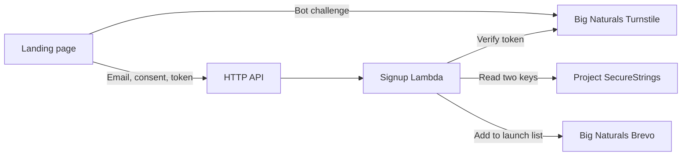

# Email signup

Configured and enabled in source. The Cloudflare public site key
is saved, and the new business Brevo list ID is `4`. Both repository secret names
were verified on November 4, 2026; their values have not been read or validated.
The access update reached `UPDATE_COMPLETE` and a read-only CDK comparison
confirmed no differences. The GitHub workflow copies the keys into AWS on
pushes to `main`; deployment status is available in
[Actions](https://github.com/big-naturals-food-co/website/actions/workflows/deploy.yml).
`signup.json` is the shared,
public configuration for Nuxt and CDK. Setting `enabled: false` hides the form
and makes the API reject intake without contacting providers.

## Request flow



The function checks the exact origin, JSON content type, payload size, email,
consent, source and empty honeypot. Turnstile must return success with the
canonical hostname and action `subscribe`. API Gateway accepts only
`POST /subscribe` and CORS preflight, with a 2 request/second rate and burst of
5. Throttling is best effort and shared across visitors.

Brevo stores contacts in one configured list. This is a single-opt-in form;
the checkbox requests email updates, not a transactional confirmation email.
Existing list members receive the same generic success response. Global
blocklists and list unsubscribes are preserved; unsupported consent-group
configuration fails closed. No email is sent by this code. Any welcome email
requires a separate Brevo automation. Use unsubscribe links in future campaigns.

The frontend shows success only after the provider operation completes (or an
existing contact needs no change). Provider errors/timeouts return 503 and keep
the visitor's email/consent available for retry with a new token. There is no
queue or automatic retry. A timeout after a Brevo write can leave the contact
saved; retrying checks membership first. Requests and contact details are never
logged. CloudWatch receives fixed outcome labels and retains logs for 30 days.

## Business ownership and provider setup

Use the new LLC's own Brevo account and Cloudflare account. Do not reuse
FishLamps keys, widgets, lists, parameters, roles, or infrastructure. No DNS move
to Cloudflare is needed. These account-owned provider assets remain in place
when AWS hosting moves.

1. In Cloudflare, create a Managed Turnstile widget named `Big Naturals Food Co.`
   allowing `bignaturalsfoodco.com`. Leave pre-clearance off. Store the public
   site key in `signup.json`; keep the secret private.
2. In Brevo, create `Big Naturals — Launch Updates` under Contacts → Lists.
   Store its numeric ID as `brevoListId` in `signup.json`. Under Settings →
   SMTP & API → API Keys & MCP, create a website key with contact read/write
   access. Save the key privately. If API IP authorization is enabled, resolve
   it before rollout: this Lambda has dynamic outbound IPs, not a fixed address.
3. Open [repository Actions secrets](https://github.com/big-naturals-food-co/website/settings/secrets/actions)
   and add `BREVO_API_KEY` and `TURNSTILE_SECRET`. Use repository secrets, not
   variables or environment secrets. No operator login or local key entry is
   required. The public widget key and list ID remain in `signup.json`.
4. Apply the access update in [ACCESS.md](ACCESS.md) when setting up an account.
   It creates the dedicated runtime role and grants the main-only GitHub role
   write access to exactly the two signup parameters. This update was applied
   and verified on November 4, 2026. The existing `AWSServiceRoleForAPIGateway` prerequisite was
   verified in the current account. In a new account, an administrator must
   create it if absent. [AWS service-linked role documentation](https://docs.aws.amazon.com/apigateway/latest/developerguide/using-service-linked-roles.html)
5. Set `enabled: true`, run the checks below, and deploy through the normal
   main-branch workflow. Before CDK deployment, the workflow copies both secrets
   to encrypted SSM SecureStrings over stdin. It rejects missing secrets, wrong
   accounts and root credentials; it never logs keys or stores them in files.
   Disabled signup skips secret writes. Writes are sequential: if the second
   fails, the first remains stored; correct the failure and rerun the latest
   main deployment. Test the real form with an email you control and confirm
   membership in Brevo list `4`.

References: [Turnstile setup](https://developers.cloudflare.com/turnstile/get-started/widget-management/dashboard/),
[server validation](https://developers.cloudflare.com/turnstile/get-started/server-side-validation/),
[Brevo API keys](https://help.brevo.com/hc/en-us/articles/40159485019794-Create-and-manage-your-API-keys),
[contact creation](https://developers.brevo.com/reference/create-contact).

## Infrastructure and deployment

`BigNaturalsFoodCoSignup` owns a dedicated certificate for
`api.bignaturalsfoodco.com`, its DNS alias, an HTTP API, Lambda and retained logs.
It uses the existing project CloudFormation service role. The administrator-owned
access stack creates the runtime role; the signup stack imports it and has no
IAM-management permissions. The runtime role reads exactly:

```text
/big-naturals-food-co/signup/brevo-api-key
/big-naturals-food-co/signup/turnstile-secret
```

These are SSM SecureStrings encrypted with the account's default SSM key.
Runtime caches them for up to 60 seconds. The GitHub deployment role can write them; the operator, GitHub
and the CloudFormation role have no direct secret-read permission. As with any code deployment role,
a principal allowed to change Lambda code can indirectly exercise its runtime
permissions, so the main-branch deployment boundary remains security-sensitive.

Lambda code is packaged inline in CloudFormation, with no shared bootstrap
bucket or cross-business assets. Node.js 24 provides the SSM SDK; its version is
managed by AWS. HTTP calls use built-in `fetch`. The inline-template size guard
still applies. The separate static site stack and its resource IDs are unchanged.

The main workflow deploys both site and signup stacks before publishing the
exact generated site artifact. API DNS/certificate creation can take several
minutes. For manual rollout, use the operator credentials, generate the frontend,
and run from `cloud/aws/`:

```sh
npm run synth
npm run cdk -- --app cdk.out deploy BigNaturalsFoodCoSite BigNaturalsFoodCoSignup --method change-set --require-approval never --outputs-file cdk.out/deploy-outputs.json
npm run publish:site -- --outputs cdk.out/deploy-outputs.json
npm run verify:site
```

To pause signups, set `enabled: false` and deploy. This hides the form and makes
the backend return 503; existing Brevo contacts remain intact. To rotate keys,
update the two repository secrets and rerun the latest main workflow. Allow
60 seconds for the runtime cache to refresh.

## Verification

From `cloud/aws/`: `npm run typecheck`, `npm test`, `npm run synth`,
`npm run synth:access`, and `npm run synth:example`.
From `web/`: `npm run typecheck`, `npm run generate`, and `npm run test:e2e`.
Browser tests start and stop their own local Nuxt server, mock both providers,
use a test-only runtime configuration, and never subscribe a real contact.
Local tests use installed Google Chrome; CI installs Playwright Chromium.

Local verification on November 4, 2026 passed 30 backend/infrastructure tests plus five secret-transfer tests,
14 Chrome browser tests across desktop and 320px layouts, TypeScript checks,
static generation, and production/example/access CDK synthesis. Browser
coverage includes success, retry, throttling, script failure, token expiry,
keyboard access, layout overflow and JavaScript-disabled behavior. This is
pre-deployment evidence only.

Production activation still requires a real Turnstile challenge, successful
API response, and confirmed contact in the correct Brevo list. Ordinary public
site verification checks the static page/assets, not provider credentials.

## Moving to the new AWS account

The current target remains `066540957026` until the planned migration. Account
age and domain-transfer eligibility must be verified at that time. The workflow
now derives account, region and site stack from `aws/project.json`.

1. Prepare the new account's hosted zone, GitHub OIDC provider, and API Gateway
   service-linked role. Recreate the
   project access stack and authenticate a new operator. The access stack
   imports an existing GitHub OIDC provider, so create that prerequisite first.
2. Update `aws/project.json` with the new account and hosted-zone ID. The workflow copies
   this business's existing repository secrets into the new account's SSM parameters. Brevo
   contacts and the Turnstile widget remain in their dedicated provider accounts.
3. Plan and review the DNS/certificate/CDN cutover before deploying. CloudFront
   aliases and API custom domains may require a staged release from the old
   account. Changing this file alone does not transfer resources or the domain.
4. Deploy and verify the new target, switch DNS using the reviewed plan, and
   preserve old resources until rollback is no longer needed. Copy any needed
   mail/verification records separately; this code does not manage them.
